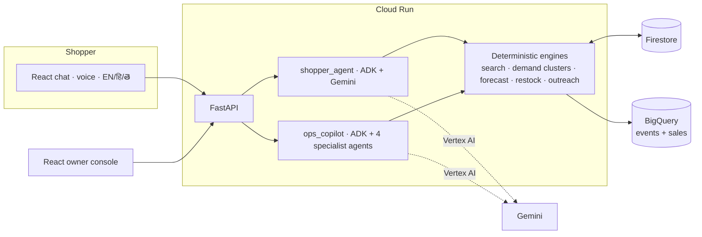

# ShelfSense

**Hear what shoppers want. Stock it. Tell them.**

ShelfSense is a multilingual shopping assistant for a neighbourhood store, paired with an owner console. The assistant helps shoppers in English, हिंदी and తెలుగు (text or voice). Every request it cannot fully serve becomes a *demand signal*. The signals are clustered, quantified and turned into concrete actions: reorder this, list that, fix this price. When the owner acts, the shoppers who asked are told, with their consent.

> Built for the Google challenge **Retail & Commerce: Intelligent Customer and Business Experiences**
> (discovery · conversational shopping · demand planning · inventory · customer insights).

## The gap it targets

A store's systems learn from what *sold*. They never learn what shoppers *wanted but couldn't get*: the item that isn't stocked, the shelf that was empty, the price that was ₹500 too high. ShelfSense captures that signal at the moment of the conversation and closes the loop in one system:

```
shopper asks ─▶ search + classify ─▶ demand signal ─▶ clusters ─▶ forecast + restock plan ─▶ owner approves ─▶ shoppers notified
   (voice/text)   in stock / out of     (logged by     "9 shoppers   (stock-out corrected,     (human in       (only those who
                  stock / over budget /  the tool, not  want gluten-   boosted by turned-away   the loop)       said yes, in their
                  substitute / not       the prompt)    free pasta")  shoppers)                                language)
                  carried
```

## Architecture



| Concern | Choice |
|---|---|
| Agents | **Google ADK**: `shopper_agent`; `ops_copilot` coordinating `demand_signal_agent`, `forecast_agent`, `inventory_agent`, `outreach_agent` as `AgentTool`s; `weekly_planning_pipeline` (`SequentialAgent`) |
| Model | **Gemini** via Vertex AI (ADC on Cloud Run) or an API key locally; model name is configuration |
| Data | **Firestore** (operational documents), **BigQuery** (event stream, sales history, BQML `ARIMA_PLUS` option, Looker Studio views) |
| Hosting | **Cloud Run** (one container serves API and UI), Secret Manager for the owner key, Cloud Logging JSON logs |
| Safety net | Every LLM path has a deterministic fallback, so the product keeps working with no credentials, no quota, or a slow model |

See [`docs/ARCHITECTURE.md`](docs/ARCHITECTURE.md) for the design decisions, [`docs/RESPONSIBLE_AI.md`](docs/RESPONSIBLE_AI.md) for privacy and safety, [`docs/DEMO_SCRIPT.md`](docs/DEMO_SCRIPT.md) for a 3-minute walkthrough and [`docs/PITCH.md`](docs/PITCH.md) for the plain-language pitch.

## What's inside

- **Need-coverage search.** Instead of "top-k similar items" (which always returns something), each product is scored by how much of the shopper's need it *covers*. That separates `in_stock`, `out_of_stock`, `over_budget`, `partial` (substitute only) and `not_carried`. Vernacular words (చక్కెర, चीनी, *chini*, *biyyam*) map to canonical terms.
- **Instrumentation in the tool, not the prompt.** `search_catalog` logs the demand signal itself, so no conversation can skip it.
- **Demand clusters.** Variants ("gluten free penne pasta under 300", "gluten-free pasta") merge; fulfilled needs are excluded; 7-day trend, unique shoppers and revenue at risk are computed.
- **Stock-out-corrected forecasting.** Empty-shelf days are re-estimated before fitting a damped Holt-Winters model, so a stock-out doesn't teach the model that demand collapsed. Shoppers turned away add an explicit uplift. A rolling backtest is exposed in the API and UI.
- **Restock engine.** Order-up-to level over lead time + review period with safety stock for a 95% service level, rounded to pack sizes, counting stock already on order. Each row explains itself.
- **Opportunities.** Unmet clusters become `new_listing`, `restock` or `price_gap` actions, with an editable suggestion and a stated-assumption estimate.
- **Consent-gated outreach.** Only shoppers who explicitly said yes, whose budget the product meets, are messaged, in their language. In-app inbox by default, optional webhook (WhatsApp/SMS bridge).
- **Production basics.** Input validation, rate limiting, owner API key, security headers, request IDs, structured logs, audit trail of every write, PII scrubbing, least-privilege agent tools.

## Run it locally (no keys needed)

```bash
make setup                      # creates backend/.venv, installs deps, npm install
make api                        # terminal 1 → http://127.0.0.1:8000  (built-in engine, synthetic store)
make web                        # terminal 2 → http://localhost:5173  (proxies /api)
make test                       # 77 backend tests
```

The UI has three views (**Side by side**, **Shopper**, **Owner**). Open *Side by side* and follow [`docs/DEMO_SCRIPT.md`](docs/DEMO_SCRIPT.md).

### With Gemini

```bash
cp .env.example .env
# Option A: API key        → GOOGLE_API_KEY=...            (LLM_MODE=auto picks it up)
# Option B: Vertex AI      → GOOGLE_GENAI_USE_VERTEXAI=true GOOGLE_CLOUD_PROJECT=... ; gcloud auth application-default login
```

`/api/health` reports `"engine": "gemini"` when the ADK path is active. The chat panel's *How the agents handled this* disclosure shows the tool calls the model made.

### Deploy to Cloud Run

```bash
PROJECT_ID=my-project REGION=asia-south1 ./deploy/setup_gcp.sh   # APIs, Firestore, service account (least privilege), secret
PROJECT_ID=my-project ./deploy/deploy.sh --demo                   # demo build: seeded store + demo helpers
PROJECT_ID=my-project ./deploy/deploy.sh                          # real deployment: no seed data, no demo endpoints
```

Optional BigQuery: `python scripts/load_bigquery.py --project my-project`, then run `sql/bqml_forecast.sql` and `sql/unmet_demand_views.sql`, and set `SALES_BACKEND=bigquery`.

## API (selected)

| Endpoint | Who | Purpose |
|---|---|---|
| `POST /api/chat` | shopper | Converse; returns reply, matches, waitlist offer, agent trace |
| `GET /api/customers/{id}/notifications` | shopper | Inbox for "it's back" messages |
| `GET /api/insights/summary` · `/unmet` · `/briefing` | owner | KPIs, need clusters, daily brief |
| `GET /api/restock/plan` | owner | Reorders and opportunities |
| `GET /api/forecast/{sku}` · `/forecast/evaluation` | owner | Forecast with backtest; fleet-level evaluation |
| `POST /api/purchase-orders` · `…/{id}/receive` · `/api/listings` | owner | Human-approved actions that trigger outreach |
| `POST /api/ops/chat` | owner | Copilot (Gemini agents, or rules engine as fallback) |

Interactive docs at `/api/docs`. Owner endpoints require `X-API-Key` when `OPS_API_KEY` is set.

## What has and hasn't been verified

Verified in the build environment: 77 automated tests (search classification across three languages, clustering, forecasting, restock maths, the full ask → consent → list → notify loop, API validation / auth / rate limiting, the **real ADK Runner with a scripted model** exercising tool calls and state, and the BigQuery sales adapter against a fake client); lint and format clean; frontend type-check and production build; a headless-browser run of the full loop; a clean-virtualenv install replicating the Docker install step and a production-mode start.

**Not exercised here** (needs credentials or services the build environment didn't have): live Gemini responses, Firestore, BigQuery, Secret Manager, the Docker image build itself, and Cloud Run deployment. Those paths are implemented and reviewed but should be smoke-tested in your project first (`/api/health`, one chat turn, one `POST /api/listings`).

## Honest limits

- **Synthetic data.** The demo store, sales and shopper history are generated. The forecast backtest on it (≈23% lower WAPE than "repeat last week", ≈4% lower than a moving average) shows the method works as designed, not how it performs on your shop. The larger value is stock-out correction and the demand signal, not a fancier curve. Run `make eval` to reproduce.
- **Demand sizing is an assumption.** Weekly-unit estimates scale observed shoppers by `ASSISTANT_REACH` (default 30%) and `CAPTURE_RATE` (default 50%). Both are stated in the UI rationale and configurable. Treat them as a starting hypothesis and pilot small.
- **Clustering is lexical** (token overlap + synonym map). Embedding-based clustering with Gemini embeddings is the natural next step for large vocabularies.
- **Customer identity in the demo is an opaque ID.** A real deployment should put Firebase Auth / Identity Platform in front of the shopper endpoints.
- **In-memory ADK sessions** by default; set `SESSION_DB_URL` (or use Cloud Run session affinity as configured) for multi-instance scale.
