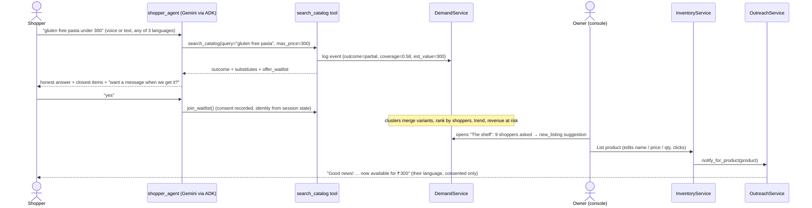

# Architecture & design decisions

## 1. The closed loop

## 2. Components

| Module | Responsibility |
|---|---|
| `textutil.py` | Tokenising that keeps Indic combining marks, stemming, vernacular synonym map, budget parsing, language detection, PII scrub, input sanitising |
| `services/catalog.py` | IDF-weighted **need coverage** scoring → `SearchResult` with one of five outcomes |
| `services/demand.py` | Event capture, clustering (Jaccard ≥ 0.6 on canonical tokens, most frequent phrasing as centroid), KPIs, consented waitlist |
| `services/forecast.py` | Stock-out correction, damped Holt-Winters (weekly), prediction bands, signal uplift, rolling backtest vs baselines |
| `services/inventory.py` | `RestockService` (reorders + opportunities) and `InventoryService` (PO approve/receive, list product, receive stock): every write is audited |
| `services/outreach.py` | Matching waitlist ↔ product (coverage + budget + consent), templated multilingual messages, pluggable channels |
| `agents/` | ADK tools, agent definitions, runtime (sessions, event parsing → structured reply + trace) |
| `shopper.py` / `ops.py` | Deterministic conversation and owner copilot (offline mode and fallback) |
| `store.py` | `DocStore` protocol: in-memory and Firestore; `Repo[T]` typed view |
| `api/` | FastAPI app, auth guard, rate limiter, JSON logging |

## 3. Decisions worth defending

**Deterministic engines, LLM at the edges.** Search classification, clustering, forecasting, restock maths and matching are plain code: testable, auditable, cheap, and identical with or without a model. Gemini handles language (understanding a request in Telugu, writing a warm reply, answering the owner's free-form questions) and *chooses which tool to call*. Numbers shown to the owner never come from the model's imagination.

**Instrumentation lives in the tool.** `search_catalog` both searches and logs the demand signal. The model can't forget to record a need, and a prompt-injected conversation can't suppress it.

**Least privilege per agent.** The shopper agent has two tools: search (reads catalogue, writes the shopper's own signal) and join-waitlist (consent for the *session's* pending offer). It cannot touch prices, stock or other customers. Identity and the pending offer come from server-set session state, never from model arguments. Owner-side agents are read-only: they *propose*; a human click executes.

**Human in the loop for money.** Purchase orders, new listings and outbound messages are triggered by explicit owner actions and written to an audit log. Estimates are editable and labelled as estimates.

**Graceful degradation.** `/api/chat` wraps the Gemini path in a timeout and falls back to the deterministic engine (reply tagged `engine: offline-fallback`). With no credentials at all the system runs entirely on the built-in engine. The demo, tests and CI need no secrets.

**Stock-out correction.** If an item was empty for 5 days, its recorded sales are ~0, and a naive model concludes demand vanished and under-orders, which causes the next stock-out. Empty-shelf days are imputed from the same weekday's in-stock history before fitting.

**Coverage, not similarity.** Nearest-neighbour search always returns something. IDF-weighted coverage of the shopper's *stated* need says how well it is actually met, which is what makes "not carried" and "substitute only" detectable. Thresholds (0.75 full, 0.34 partial) are configuration.

## 4. Data model (Firestore collections)

`products` · `customers` · `events` (demand events) · `waitlist` (with `consent_at`) · `notifications` · `purchase_orders` · `audit` · `sessions`. BigQuery: `demand_events` (streamed), `sales_daily` (loaded).

## 5. Scaling notes

- **Catalogue size:** the in-process index suits thousands of SKUs. For large catalogues swap `CatalogService.search` for Vertex AI Search for commerce behind the same `SearchResult` contract.
- **Forecast volume:** the in-process model is per-SKU on demand with caching; for fleet scale use `sql/bqml_forecast.sql` (BQML `ARIMA_PLUS`) or Vertex AI Forecast.
- **Statelessness:** documents live in Firestore; ADK sessions are in-memory by default (Cloud Run session affinity is enabled in `cloudbuild.yaml`); set `SESSION_DB_URL` to persist.
- **Rate limiting** is per-instance; put Cloud Armor / API Gateway in front for fleet-wide limits.
- **Notifications:** `WebhookChannel` posts each message to a URL, the hook for a WhatsApp Business / SMS provider (templates and opt-in rules of the provider apply).

## 6. Known simplifications

Lexical clustering; templated outreach copy; single store (no multi-tenant isolation); no real payments or order flow (the signal is the product); demo shopper identity is an opaque ID.
